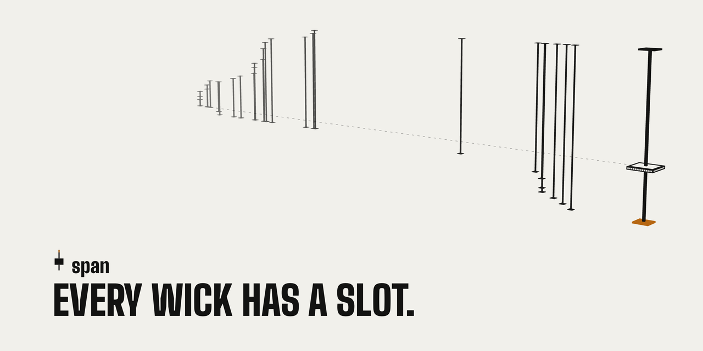

<p align="center">
  
</p>

<h3 align="center">SOL's release-hour candle, settled by its length. Wicks included.</h3>

<p align="center">
  <a href="https://span.press">span.press</a> ·
  <a href="https://span.press/#docs">Docs</a> ·
  <a href="https://span.press/#book">Book</a> ·
  <a href="https://x.com/spancandle">X</a> ·
  <a href="#build-and-verify">Verify the bytes</a>
</p>

A US release moves SOL in the hour after the print, and the move can come back before the hour is out. A perp settles that hour on its body, open to close. span settles it on the candle, from the top of the upper wick to the bottom of the lower one.

A candle is 60 minutes and starts on a minute. The site lists one for every scheduled CPI, PPI and jobs print (08:30 ET) and FOMC decision (14:00 ET), starting one minute before it. A seller opens a ticket with a length, 0 to 5% in 0.25% steps, and puts 40 USDC less the premium into its vault. A buyer pays the premium, 0.10 to 39 USDC. At the close the buyer receives 10 USDC for every 1% of candle past the length, up to the 40 USDC in the vault, and the seller receives the rest. Which way the hour went and where it closed do not enter the payout.

Thirteen scheduled reads, one every 300 seconds, draw the candle anyone can record. The part of a long candle past a ticket's length is usually a wick that reached out between two reads right after the print and came back before the next one. A ticket that carries SPAN names a reader who records each new high or low as it happens: one transaction, one slot, one wick. A record that raises the payout burns a fixed amount of SPAN; a record that does not burns nothing. A recorded wick never shrinks.

Program: `ED2a4EqgPCKRiAV1rF4pK3r44w8xzhU8h9VLYGTXNEMd`.

## The rule

The payout fits in one function, [`math.rs`](program/programs/span/src/math.rs#L8-L19). `strike_bps` is the ticket's length in basis points; prices carry eight decimals and the result is in USDC base units.

```rust
pub fn payout(p0: u64, high: u64, low: u64, strike_bps: u16) -> Result<u64> {
    require!(p0 > 0 && high >= low, SpanError::InvalidValue);
    let width = u128::from(high.checked_sub(low).ok_or(SpanError::Overflow)?);
    let numerator = width
        .checked_mul(1_000_000_000)
        .ok_or(SpanError::Overflow)?;
    let raw = numerator
        .checked_div(u128::from(p0))
        .ok_or(SpanError::Overflow)?;
    let strike = u128::from(strike_bps).checked_mul(100_000).ok_or(SpanError::Overflow)?;
    Ok(raw.saturating_sub(strike).min(u128::from(VAULT_CAP)) as u64)
}
```

A wick record is the `mark` instruction, [`lib.rs`](program/programs/span/src/lib.rs#L445-L456):

```rust
let (high, low) = t.high_low(candle);
let side = math::extends(price.price, high, low, p0, t.step_bps)?
    .ok_or(SpanError::NotExtension)?;
require!(
    math::payout(p0, high, low, t.strike_bps)? < VAULT_CAP,
    SpanError::CapReached
);
let burn_per_mark = ctx.accounts.gate.config.burn_per_mark;
require!(ctx.accounts.span_hold.amount >= burn_per_mark, SpanError::SpanShort);
let before = math::payout(p0, high, low, t.strike_bps)?;
let after = math::payout(p0, if side { price.price } else { high }, if side { low } else { price.price }, t.strike_bps)?;
let burn = if after > before { burn_per_mark } else { 0 };
```

`extends` accepts a price only if it lies at least one stride past the ticket's high or low. The buyer picks the stride, 2, 5, 10 or 25 bp of the open, when loading SPAN. `high` only rises and `low` only falls. SPAN burns when `after > before`, so a wick still inside the ticket's length is kept without a burn. Every mark needs one burn amount in the ticket, paid or not.

## Seven release hours

[`program/tests/replay-vectors.json`](program/tests/replay-vectors.json) holds the program's own results for the 2026 release hours below. The replay test sends every DOVES write of each hour through the program in LiteSVM, in order. Each write can fill a due read and add a mark wherever the 5 bp stride accepts it. The test fails if any value differs. The candle columns are the vectors' `readPayout` and `payout` at length 0. The ticket columns apply `payout` at 200 and 300 bp to the same high and low, and read "reads only → with wicks", in USDC.

| Hour (ET) | Reads only | With wicks | Wick records | 2% ticket | 3% ticket |
| --- | ---: | ---: | ---: | ---: | ---: |
| Jobs · Sep 4, 08:30 | 3.04% | **3.96%** | 22 | 10.43 → **19.60** | 0.43 → **9.60** |
| PPI · Sep 10, 08:30 | 2.23% | **2.72%** | 25 | 2.25 → **7.16** | 0 → 0 |
| CPI · Sep 11, 08:30 | 2.58% | **3.55%** | 29 | 5.77 → **15.53** | 0 → **5.53** |
| FOMC · Sep 16, 14:00 | 1.74% | **2.63%** | 31 | 0 → **6.29** | 0 → 0 |
| Jobs · Oct 2, 08:30 | 1.02% | **1.21%** | 15 | 0 → 0 | 0 → 0 |
| CPI · Oct 14, 08:30 | 2.65% | **3.03%** | 26 | 6.53 → **10.28** | 0 → **0.28** |
| PPI · Oct 15, 08:30 | 0.71% | **0.96%** | 9 | 0 → 0 | 0 → 0 |

From reads alone, a 3% ticket would have paid on one of these hours, 0.43 USDC. With its wicks recorded it would have paid on three, 15.41 USDC. Past a length, most of a payout is wick: 58% of the 2% total and 97% of the 3% total.

The tape decodes the same DOVES transactions live in [`keeper/src/tape/doves-tx.ts`](keeper/src/tape/doves-tx.ts). The vector file also covers two US market opens and the 2, 10 and 25 bp strides.

## How an hour runs

```text
t0 − 5 s          buying closes
t0                read 0   the open, P0
t0 + 300·j        read j   j = 1…12, published within 20 s, at most 20 s old
(t0, t0 + 3600]   mark     one stride past the ticket's high or low; its reader only
t0 + 3641         settle   anyone; USDC to both sides, unburned SPAN to the buyer
```

`t0` is the candle's start. Anyone may send a read. A read that misses its window stays empty and adds no price. Without the open, the buyer gets the premium back and the seller the collateral. An unsold ticket returns the collateral. The times use the default Config, a 20-second read window, a 20-second age limit and a 5-second buying cutoff, which each candle copies when it opens.

## Accounts

| Account | Contents |
|---|---|
| Config | Admin, USDC and oracle addresses, timing parameters, optional SPAN mint and burn amount |
| Candle | Start time, copied timing parameters, thirteen readings, read high and low |
| Ticket | Seller, optional buyer, premium, length, reader, SPAN load, tail high and low, marks and burned amount |
| Vault | Ticket's classic Token USDC account |
| SPAN holding account | Ticket's unburned SPAN |

## Instructions and events

| Instruction | Event | Effect |
|---|---|---|
| init | Initialized | Create Config; upgrade authority only |
| set_span | SpanSet | Choose the mint and burn amount once; admin only |
| set_feed | FeedSet | Change the validated SOL oracle; admin only |
| set_params | ParamsSet | Change timing for future candles; admin only |
| open_candle | CandleOpened | Open a minute-aligned candle |
| open_ticket | TicketOpened | Deposit 40 minus premium USDC and set the length |
| withdraw | Withdrawn | Return collateral while the ticket remains unsold; seller only |
| buy | Bought | Pay the premium into the vault |
| load_span | SpanLoaded | Load SPAN and select a reader and stride |
| read | Read | Fill a scheduled reading during its window |
| mark | Marked | Record a wick extension; burn SPAN only when it raises the payout |
| settle | Settled | Distribute USDC and return unburned SPAN |

## Settlement

Let P0 be the opening reading, H the greatest scheduled reading or accepted upper tail, and L the least scheduled reading or accepted lower tail. Buyer payout in USDC base units is `min(40_000_000, max(floor(1_000_000_000 * (H - L) / P0) - strike_bps * 100_000, 0))`. The seller receives the rest of the 40 USDC vault. Settlement is available after start plus 3,600 seconds, the read window, the age limit and one second.

## Authority

The admin can set SPAN once, change the feed, and change timing parameters within the program's bounds. These instructions cannot withdraw users' collateral or rewrite an existing candle's parameters. Report vulnerabilities as described in [SECURITY.md](SECURITY.md).

## Oracle

DOVES SOL account: `FYq2BWQ1V5P1WFBqr3qB2Kb5yHVvSv7upzKodgQE5zXh`, owned by `DoVEsk76QybCEHQGzkvYPWLQu9gzNoZZZt3TPiL597e`. Jupiter perps fill against this price. The account is 394 bytes. Bytes 0–7 are discriminator `70f98bd9d7d0f936`, bytes 8–39 identify wrapped SOL, bytes 168–175 contain an unsigned little-endian price scaled by 100,000,000, byte 176 is 248, and bytes 177–184 contain the signed little-endian publication timestamp. The program validates this layout, owner, asset, positive price and age. Development-only feed commands are excluded from the default build.

## Run a keeper

Requires Node 26.11.1. Install dependencies in both packages with `npm --prefix program ci` and `npm --prefix keeper ci`. Set `SPAN_CLUSTER=mainnet`, `KEEPER_KEYPAIR` to a private wallet file outside version control, and `KEEPER_ALLOW_MAINNET=1`, then run `npm --prefix keeper run keeper`. Run `npm --prefix keeper run tape` separately. See [keeper configuration](keeper/README.md) and the service templates in `keeper/deploy`. Set `KEEPER_RELEASE_HOURS=1` to open and read every scheduled release hour, as the public keeper does.

Anyone may submit scheduled readings or settle a ticket. Only the reader chosen for a ticket may submit its tail marks. Use a separate fee wallet per keeper process. The tape serves cached JSON files and accepts no browser RPC requests.

## Build and verify

Use Agave 3.1.10, Anchor 1.1.2 and solana-verify 0.5.2. From `program`, run `NO_DNA=1 npm run build`, `npm run typecheck` and `npm test`. This builds a default binary and a separate development test binary. The historical replay runs when `SPAN_REPLAY_DIR` points to a directory of rebuilt DOVES writes.

For a verifiable default build, run `NO_DNA=1 solana-verify build --library-name span` from `program`. Compare `solana-verify get-executable-hash target/deploy/span.so` with `solana-verify get-program-hash ED2a4EqgPCKRiAV1rF4pK3r44w8xzhU8h9VLYGTXNEMd --url https://api.mainnet-beta.solana.com`. The Actions workflow also publishes the executable and its SHA-256.
