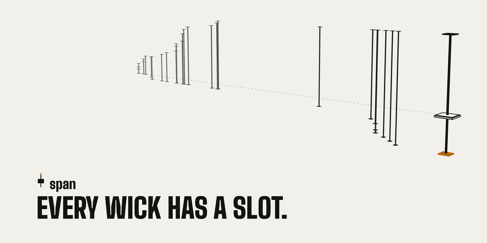

<p align="center">
  
</p>

<h3 align="center">SOL's release-hour candle, settled by its length. Wicks included.</h3>

<p align="center">
  <a href="https://span.press">span.press</a> ·
  <a href="https://span.press/#docs">Docs</a> ·
  <a href="https://span.press/#book">Book</a> ·
  <a href="https://x.com/spancandle">X</a> ·
  <a href="#build-and-verify">Verify the bytes</a>
</p>

A US release moves SOL in the hour after the print, and the move can come back before the hour is out. A perp settles that hour on its body, open to close. span settles it on the candle, from the top of the upper wick to the bottom of the lower one.

A candle is 60 or 30 minutes, and its start second names its asset and its length: a 60-minute SOL candle starts on a minute, BTC one second after it and ETH two seconds after; a 30-minute candle starts three, four or five seconds after the minute for SOL, BTC or ETH. The site lists one for every scheduled CPI, PPI, jobs and GDP print (08:30 ET) and FOMC decision (14:00 ET), starting one minute before it. A seller opens a ticket with a length, 0 to 5% in 0.25% steps, and puts 40 USDC less the premium into its vault. A buyer pays the premium, 0.10 to 39 USDC. At the close the buyer receives 10 USDC for every 1% of candle past the length, up to the 40 USDC in the vault, and the seller receives the rest. Which way the hour went and where it closed do not enter the payout.

Scheduled reads, one every 300 seconds, thirteen on a 60-minute candle and seven on a 30-minute one, draw the candle anyone can record. The part of a long candle past a ticket's length is usually a wick that reached out between two reads right after the print and came back before the next one. A ticket that carries SPAN names a reader who records each new high or low as it happens: one transaction, one slot, one wick. A record that raises the payout burns a fixed amount of SPAN; a record that does not burns nothing. A recorded wick never shrinks.

Program: `ED2a4EqgPCKRiAV1rF4pK3r44w8xzhU8h9VLYGTXNEMd`.

## The rule

The payout fits in one function, [`math.rs`](program/programs/span/src/math.rs#L8-L19). `strike_bps` is the ticket's length in basis points; prices carry eight decimals and the result is in USDC base units.

```rust
pub fn payout(p0: u64, high: u64, low: u64, strike_bps: u16) -> Result<u64> {
    require!(p0 > 0 && high >= low, SpanError::InvalidValue);
    let width = u128::from(high.checked_sub(low).ok_or(SpanError::Overflow)?);
    let numerator = width
        .checked_mul(1_000_000_000)
        .ok_or(SpanError::Overflow)?;
    let raw = numerator
        .checked_div(u128::from(p0))
        .ok_or(SpanError::Overflow)?;
    let strike = u128::from(strike_bps).checked_mul(100_000).ok_or(SpanError::Overflow)?;
    Ok(raw.saturating_sub(strike).min(u128::from(VAULT_CAP)) as u64)
}
```

A wick record is the `mark` instruction, [`lib.rs`](program/programs/span/src/lib.rs#L1247-L1258):

```rust
let (high, low) = t.high_low(candle);
let side = math::extends(price.price, high, low, p0, t.step_bps)?
    .ok_or(SpanError::NotExtension)?;
require!(
    math::payout(p0, high, low, t.strike_bps)? < VAULT_CAP,
    SpanError::CapReached
);
let burn_per_mark = ctx.accounts.gate.config.burn_per_mark;
require!(ctx.accounts.span_hold.amount >= burn_per_mark, SpanError::SpanShort);
let before = math::payout(p0, high, low, t.strike_bps)?;
let after = math::payout(p0, if side { price.price } else { high }, if side { low } else { price.price }, t.strike_bps)?;
let burn = if after > before { burn_per_mark } else { 0 };
```

`extends` accepts a price only if it lies at least one stride past the ticket's high or low. The buyer picks the stride, 2, 5, 10 or 25 bp of the open, when loading SPAN. `high` only rises and `low` only falls. SPAN burns when `after > before`, so a wick still inside the ticket's length is kept without a burn. Every mark needs one burn amount in the ticket, paid or not.

## Seven release hours

[`program/tests/replay-vectors.json`](program/tests/replay-vectors.json) holds the program's own results for the 2026 release hours below. The replay test sends every DOVES write of each hour through the program in LiteSVM, in order. Each write can fill a due read and add a mark wherever the 5 bp stride accepts it. The test fails if any value differs. The candle columns are the vectors' `readPayout` and `payout` at length 0. The ticket columns apply `payout` at 200 and 300 bp to the same high and low, and read "reads only → with wicks", in USDC.

| Hour (ET) | Reads only | With wicks | Wick records | 2% ticket | 3% ticket |
| --- | ---: | ---: | ---: | ---: | ---: |
| Jobs · Sep 4, 08:30 | 3.04% | **3.96%** | 22 | 10.43 → **19.60** | 0.43 → **9.60** |
| PPI · Sep 10, 08:30 | 2.23% | **2.72%** | 25 | 2.25 → **7.16** | 0 → 0 |
| CPI · Sep 11, 08:30 | 2.58% | **3.55%** | 29 | 5.77 → **15.53** | 0 → **5.53** |
| FOMC · Sep 16, 14:00 | 1.74% | **2.63%** | 31 | 0 → **6.29** | 0 → 0 |
| Jobs · Oct 2, 08:30 | 1.02% | **1.21%** | 15 | 0 → 0 | 0 → 0 |
| CPI · Oct 14, 08:30 | 2.65% | **3.03%** | 26 | 6.53 → **10.28** | 0 → **0.28** |
| PPI · Oct 15, 08:30 | 0.71% | **0.96%** | 9 | 0 → 0 | 0 → 0 |

From reads alone, a 3% ticket would have paid on one of these hours, 0.43 USDC. With its wicks recorded it would have paid on three, 15.41 USDC. Past a length, most of a payout is wick: 58% of the 2% total and 97% of the 3% total.

The tape decodes the same DOVES transactions live in [`keeper/src/tape/doves-tx.ts`](keeper/src/tape/doves-tx.ts). The vector file also covers two US market opens and the 2, 10 and 25 bp strides.

## How an hour runs

```text
t0 − 5 s          buying closes
t0                read 0   the open, P0
t0 + 300·j        read j   j = 1…12, published within 20 s, at most 20 s old
(t0, t0 + 3600]   mark     one stride past the ticket's high or low; its reader only
t0 + 3641         settle   anyone; USDC to both sides, unburned SPAN to the buyer
```

`t0` is the candle's start. Anyone may send a read. A read that misses its window stays empty and adds no price. Without the open, the buyer gets the premium back and the seller the collateral. An unsold ticket returns the collateral. The times use the default Config, a 20-second read window, a 20-second age limit and a 5-second buying cutoff, which each candle copies when it opens. A 30-minute candle runs the same way to `t0 + 1800`: reads 0…6, the last at its end and published within the same window, marks published through `t0 + 1800`, and settlement from `t0 + 1841`.

## Accounts

| Account | Contents |
|---|---|
| Config | Admin, USDC and oracle addresses, timing parameters, optional SPAN mint and burn amount |
| Candle | Start time, copied timing parameters, thirteen readings, read high and low |
| Ticket | Seller, optional buyer, premium, length, reader, SPAN load, tail high and low, marks and burned amount |
| Until | Optional per ticket: the time its seller keeps it for sale inside its hour |
| Resale | Optional per ticket: its buyer's price for the rest of the hour and the time the offer stands |
| Bid | Optional per ticket and bidder: a price for the rest of the hour, the most the bidder will pay, the time the bid stands, the USDC behind it and any SPAN to load |
| Request | Optional per candle start, ticket length and requester: a price for the rest of the hour, the most the requester will pay, the time the request stands, the least room left to 40 USDC it accepts, the USDC behind it and any SPAN to load |
| Vault | Ticket's classic Token USDC account |
| SPAN holding account | Ticket's unburned SPAN |

## Instructions and events

| Instruction | Event | Effect |
|---|---|---|
| init | Initialized | Create Config; upgrade authority only |
| set_span | SpanSet | Choose the mint and burn amount once; admin only |
| set_feed | FeedSet | Change the validated SOL oracle; admin only |
| set_params | ParamsSet | Change timing for future candles; admin only |
| open_candle | CandleOpened | Open a 60-minute candle on a minute (SOL), or one or two seconds after it (BTC, ETH); three to five seconds after it, a 30-minute candle |
| open_ticket | TicketOpened | Deposit 40 minus premium USDC and set the length |
| open_running | TicketOpened, UntilSet | Open a ticket that stays for sale after its hour starts, until a time the seller sets |
| withdraw | Withdrawn | Return collateral while the ticket remains unsold; seller only |
| buy | Bought | Pay the premium into the vault |
| buy_running | BoughtRunning | After the opening reading, pay what the candle has recorded plus the premium, up to a stated maximum |
| load_span | SpanLoaded | First load of SPAN and selection of a reader and stride; buyer only |
| set_marker | MarkerSet | Change the reader of a loaded Sold ticket; buyer only |
| read | Read | Fill a scheduled reading during its window |
| mark | Marked | Record a wick extension; burn SPAN only when it raises the payout |
| settle | Settled | Distribute USDC and return unburned SPAN |
| close_until | UntilClosed | Stop selling a ticket inside its hour (seller), or return the account's rent once the ticket is closed (anyone) |
| list_resale | ResaleListed | Offer a bought ticket for the rest of its hour at a price, until a time; buyer only |
| buy_resale | Resold | After the opening reading, pay the holder what the candle has recorded plus their price, up to a stated maximum, and become the ticket's buyer |
| close_resale | ResaleClosed | Withdraw an offer (holder), or return the account's rent once the ticket is closed (anyone) |
| place_bid | BidPlaced | Bid for a bought ticket: a price for the rest of its hour, the most you will pay and a time, with that most held in USDC by the bid; anyone but the ticket's buyer |
| bid_span | BidSpan | Add SPAN, a step and a reader to your bid, to be loaded onto the ticket if the bid is taken; bidder only |
| accept_bid | BidAccepted | After the opening reading, take a bid on your ticket: receive what the candle has recorded plus the bid's price, return the rest of its USDC to the bidder, make the bidder the ticket's buyer and load its SPAN; buyer only |
| close_bid | BidClosed | Withdraw a bid with its USDC and SPAN (bidder), or return them once its time has passed or the ticket is closed (anyone) |
| place_request | RequestPlaced | Ask for a ticket of a candle and length without choosing one: a price for the rest of its hour, the most you will pay, a time and the least room left to 40 USDC you accept, with that most held in USDC by the request; the candle need not exist yet |
| request_span | RequestSpan | Add SPAN, a step and a reader to your request, to be loaded onto the ticket it is filled with; requester only |
| fill_request_held | RequestFilled | After the opening reading, fill a request with your ticket of its candle and length, as `accept_bid` takes a bid; buyer only |
| fill_request_open | TicketOpened, RequestFilled | Before the buying cutoff, fill a request with a new ticket at its price: you put in 40 USDC less the price and the request pays the price; anyone but the requester |
| fill_request_running | TicketOpened, RequestFilled | After the opening reading, fill a request with a new ticket bought as with `buy_running`; anyone but the requester |
| close_request | RequestClosed | Withdraw a request with its USDC and SPAN (requester), or return them once its time has passed (anyone) |

First loading and reader changes are allowed through the candle's end plus `age_limit`, inclusive: `t0 + 3600 + age_limit`, or `t0 + 1800 + age_limit` on a 30-minute candle. Changing the reader preserves the recorded tails, mark count, burned amount and token balance. A resale returns the holder's SPAN and clears the reader; the recorded tails, mark count and burned amount stay with the ticket. Taking a bid does the same, then loads the bid's SPAN with its step and reader. Filling a request with a held ticket does the same, and a ticket opened to fill a request starts with the request's SPAN, step and reader. Buying and selling still close at the buying cutoff, except for a ticket opened with `open_running`.

## Buying inside the hour

A ticket opened with `open_running` stays for sale after its hour starts, until the time its seller set, at most the candle's end, start plus 3,600 or 1,800 seconds. Before the cutoff it is bought with `buy` at its premium. After the opening reading, `buy_running` reads the current DOVES price with the same checks as `mark` and computes A, the payout of the high and low so far with that price included. The buyer pays A plus the premium. If the price extends the high or low, it is kept as the ticket's tail without burning SPAN, so the final payout cannot fall below A. A ticket with A at 40 USDC is not sold.

## Selling a ticket inside the hour

A ticket's buyer can offer it with `list_resale` at a price, 0.10 to 39 USDC, until a time no later than the candle's end. After the opening reading, `buy_resale` computes A, the payout of the high and low recorded so far, without reading a new price, and the new buyer pays A plus that price straight to the holder. The vault does not move, so the seller's side is unchanged, and since a recorded high or low never shrinks, the final payout cannot fall below A. The holder's unburned SPAN and the rent of its holding account go back to the holder. A resale records no price, so a wick enters the ticket only through a read or a mark. It waits while a scheduled read can still be filled, from its open window or from the price already in the DOVES account; the buyer can send that read first in the same transaction. A ticket with A at 40 USDC is not resold.

## Bidding for a ticket inside the hour

Anyone but a ticket's buyer can bid for it with `place_bid`: a price for the rest of the hour, 0.10 to 39 USDC, the most they will pay in all, and a time no later than the candle's end. The bid holds that most in USDC, and `bid_span` can add SPAN with a step and a reader. After the opening reading, the buyer can take a bid with `accept_bid`. A is computed as in `buy_resale`, from the high and low recorded so far, and the bid waits under the same rule while a scheduled read can still be filled. The buyer receives A plus the bid's price, never more than the bid's most; the bidder gets the rest of its USDC back and becomes the ticket's buyer. The buyer's unburned SPAN and the lamports of its holding account go back to the buyer, and in the same transaction the bid's SPAN is loaded into a new holding account whose rent the bid set aside. A recorded high or low never shrinks, so A only grows while a bid stands and the final payout cannot fall below it. A buyer with an open resale offer closes it before taking a bid. The vault does not move, so the seller's side is unchanged.

## Requesting a ticket

Anyone can ask for a ticket without choosing one with `place_request`: a candle start, which names its asset and its length, a ticket length, a price for the rest of the hour, 0.10 to 39 USDC, the most they will pay in all, a time no later than the candle's end, and the least room left to 40 USDC they will accept. The request holds that most in USDC, the candle need not exist yet, and `request_span` can add SPAN with a step and a reader. A request is filled once, with one ticket, in one of three ways. After the opening reading, the buyer of a ticket of that candle and length can fill it with `fill_request_held`, under the rules and price of `accept_bid`. Before the buying cutoff, a seller can fill it with `fill_request_open`: a new ticket at the request's price, the seller putting in 40 USDC less that price and the request paying the price, as `open_ticket` and `buy` would. After the opening reading, a seller can fill it with `fill_request_running`: a new ticket bought as with `buy_running`, with the current DOVES price in A. Each way, the requester pays no more than the request's most, the ticket keeps at least the requested room below 40 USDC, the requester becomes the ticket's buyer, and the request's SPAN is loaded in the same transaction. The rest of the USDC goes back to the requester. A seller's risk on a ticket opened this way is the same as on any ticket: at most 40 USDC less its price.

## Settlement

Let P0 be the opening reading, H the greatest scheduled reading or accepted upper tail, and L the least scheduled reading or accepted lower tail. Buyer payout in USDC base units is `min(40_000_000, max(floor(1_000_000_000 * (H - L) / P0) - strike_bps * 100_000, 0))`. The seller receives the rest of the vault: 40 USDC, plus A for a ticket bought inside the hour. A resold ticket pays its last buyer, and the seller's share is the same as without the resale. A ticket that changed hands through a bid settles the same way. So does a ticket filled for a request. Settlement is available after the candle's end, the read window, the age limit and one second.

## Authority

The admin can set SPAN once, change the feed, and change timing parameters within the program's bounds. These instructions cannot withdraw users' collateral or rewrite an existing candle's parameters. Report vulnerabilities as described in [SECURITY.md](SECURITY.md).

## Oracle

DOVES SOL account: `FYq2BWQ1V5P1WFBqr3qB2Kb5yHVvSv7upzKodgQE5zXh`, owned by `DoVEsk76QybCEHQGzkvYPWLQu9gzNoZZZt3TPiL597e`. Jupiter perps fill against this price. The account is 394 bytes. Bytes 0–7 are discriminator `70f98bd9d7d0f936`, bytes 8–39 identify wrapped SOL, bytes 168–175 contain an unsigned little-endian price scaled by 100,000,000, byte 176 is 248, and bytes 177–184 contain the signed little-endian publication timestamp. The program validates this layout, owner, asset, positive price and age. Development-only feed commands are excluded from the default build.

BTC candles read only the DOVES BTC account `hUqAT1KQ7eW1i6Csp9CXYtpPfSAvi835V7wKi5fRfmC` and ETH candles only the DOVES ETH account `AFZnHPzy4mvVCffrVwhewHbFc93uTHvDSFrVH7GtfXF1`. Both have the same owner and layout; bytes 8–39 hold the asset's mint, `3NZ9JMVBmGAqocybic2c7LQCJScmgsAZ6vQqTDzcqmJh` for BTC and `7vfCXTUXx5WJV5JADk17DUJ4ksgau7utNKj4b963voxs` for ETH. Read boundaries and the mark window start from the candle's own start, so a BTC candle's are one second later than the SOL candle's of the same hour.

## Run a keeper

Requires Node 26.11.1. Install dependencies in both packages with `npm --prefix program ci` and `npm --prefix keeper ci`. Set `SPAN_CLUSTER=mainnet`, `KEEPER_KEYPAIR` to a private wallet file outside version control, and `KEEPER_ALLOW_MAINNET=1`, then run `npm --prefix keeper run keeper`. Run `npm --prefix keeper run tape` separately. See [keeper configuration](keeper/README.md) and the service templates in `keeper/deploy`. Set `KEEPER_RELEASE_HOURS=1` to open and read every scheduled release hour, as the public keeper does. Set `SPAN_EVENT_HOURS` to a listed-hours file to open and read those hours too.

Anyone may submit scheduled readings or settle a ticket. Only the reader chosen for a ticket may submit its tail marks. Use a separate fee wallet per keeper process. The tape serves cached JSON files and accepts no browser RPC requests.

## Build and verify

Use Agave 3.1.10, Anchor 1.1.2 and solana-verify 0.5.2. From `program`, run `NO_DNA=1 npm run build`, `npm run typecheck` and `npm test`. This builds a default binary and a separate development test binary. The historical replay runs when `SPAN_REPLAY_DIR` points to a directory of rebuilt DOVES writes.

For a verifiable default build, run `NO_DNA=1 solana-verify build --library-name span` from `program`. Compare `solana-verify get-executable-hash target/deploy/span.so` with `solana-verify get-program-hash ED2a4EqgPCKRiAV1rF4pK3r44w8xzhU8h9VLYGTXNEMd --url https://api.mainnet-beta.solana.com`. The Actions workflow also publishes the executable and its SHA-256.
